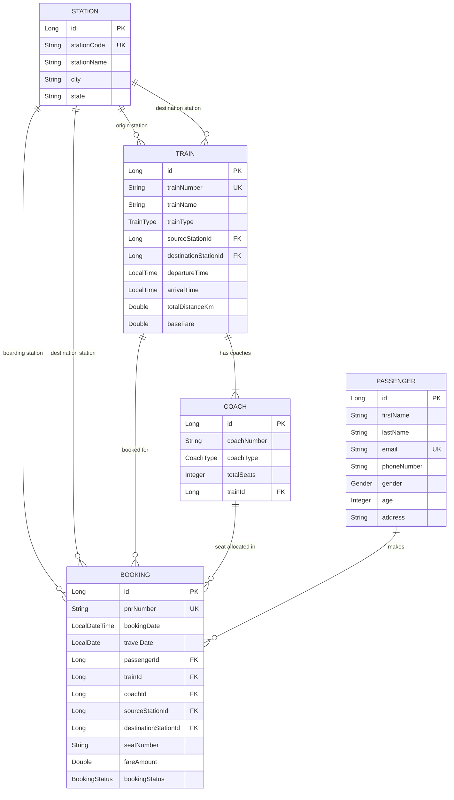

# Railway Reservation System REST API

A complete, production-ready **Railway Reservation System** backend built with **Spring Boot 3**, **Spring Data JPA**, **H2 In-Memory Database**, and **Swagger UI (Springdoc OpenAPI)** as the interactive frontend.

---

## 🌟 Key Features

- **5 Core Entities with Rich Relationships**:
  - **Stations**: Origin, destination, and transit railway stations.
  - **Trains**: Train metadata, schedules (departure/arrival), distances, base fares, and linked route stations.
  - **Coaches**: Multi-class coach configurations (`AC_FIRST_CLASS`, `AC_2_TIER`, `AC_3_TIER`, `SLEEPER`, `CHAIR_CAR`, etc.) with seat capacities and fare multipliers linked to trains.
  - **Passengers**: Passenger registration with profile and contact information.
  - **Bookings**: Ticket reservations with automatic PNR generation, smart seat allocation, dynamic fare calculation based on coach class & distance, capacity enforcement, and cancellation workflows.
- **Full CRUD Operations**: Endpoints for creating, reading, updating, searching, and deleting across all entities.
- **Frontend in Swagger UI**: Full interactive web interface at `http://localhost:8080/swagger-ui.html` (and automatic root redirect at `http://localhost:8080/`).
- **Database Connectivity**: H2 database with web console at `http://localhost:8080/h2-console`.
- **Pre-seeded Realistic Data**: Auto-loads stations (`NDLS`, `MMCT`, `HWH`, `SBC`, `MAS`), trains (Rajdhani Express, Vande Bharat, Karnataka Express), coaches, passengers, and bookings on startup.
- **Robust Exception Handling**: Global exception handler providing standardized JSON error messages and validation feedback.

---

## 🏗️ Architecture & Entity Relationships



---

## 🚀 How to Run

### Prerequisites
- **Java 17 / 21 / 24+**
- Windows, macOS, or Linux

### Running with Maven Wrapper (No Maven installation required)

On **Windows (PowerShell or Command Prompt)**:
```powershell
.\mvnw.cmd spring-boot:run
```

Or build and run the executable JAR:
```powershell
.\mvnw.cmd package -DskipTests
java -jar target/railway-reservation-system-0.0.1-SNAPSHOT.jar
```

On **Linux / macOS**:
```bash
./mvnw spring-boot:run
```

---

## 🖥️ Interactive Web Interfaces

Once the application is running:

| Interface | URL | Notes |
| :--- | :--- | :--- |
| **Swagger UI (Interactive Frontend)** | [http://localhost:8080/](http://localhost:8080/) or [http://localhost:8080/swagger-ui.html](http://localhost:8080/swagger-ui.html) | Test every endpoint with the "Try it out" feature |
| **OpenAPI JSON Spec** | [http://localhost:8080/api-docs](http://localhost:8080/api-docs) | Raw OpenAPI v3 JSON specification |
| **H2 Database Console** | [http://localhost:8080/h2-console](http://localhost:8080/h2-console) | **JDBC URL**: `jdbc:h2:mem:railwaydb`<br>**User**: `sa`<br>**Password**: *(leave empty)* |

---

## 📡 REST API Endpoints Overview

### 1. Stations (`/api/stations`)
- `POST /api/stations` - Create a new station
- `GET /api/stations` - Get all stations
- `GET /api/stations/{id}` - Get station by ID
- `GET /api/stations/code/{stationCode}` - Get station by code (e.g. `NDLS`)
- `PUT /api/stations/{id}` - Update station details
- `DELETE /api/stations/{id}` - Delete a station

### 2. Coaches (`/api/coaches`)
- `POST /api/coaches` - Add and attach coach to a train
- `GET /api/coaches` - Get all coaches
- `GET /api/coaches/{id}` - Get coach by ID
- `GET /api/coaches/train/{trainId}` - Get all coaches for a specific train
- `PUT /api/coaches/{id}` - Update coach
- `DELETE /api/coaches/{id}` - Delete coach

### 3. Trains (`/api/trains`)
- `POST /api/trains` - Create a new train with route and schedule
- `GET /api/trains` - Get all trains (includes route and coach details)
- `GET /api/trains/{id}` - Get train by ID
- `GET /api/trains/number/{trainNumber}` - Get train by train number (e.g. `12951`)
- `GET /api/trains/search?sourceStationId=1&destinationStationId=2` - Search trains between two stations
- `GET /api/trains/search/query?q=Rajdhani` - Search trains by name or number keyword
- `PUT /api/trains/{id}` - Update train details
- `DELETE /api/trains/{id}` - Delete a train

### 4. Passengers (`/api/passengers`)
- `POST /api/passengers` - Register a new passenger
- `GET /api/passengers` - Get all registered passengers
- `GET /api/passengers/{id}` - Get passenger by ID
- `GET /api/passengers/email/{email}` - Find passenger by email
- `GET /api/passengers/{id}/bookings` - View passenger's complete booking history
- `PUT /api/passengers/{id}` - Update passenger profile
- `DELETE /api/passengers/{id}` - Delete passenger profile

### 5. Bookings (`/api/bookings`)
- `POST /api/bookings` - Book a train ticket (auto-assigns seat, calculates fare, generates PNR)
- `GET /api/bookings` - Get all bookings
- `GET /api/bookings/{id}` - Get booking by ID
- `GET /api/bookings/pnr/{pnrNumber}` - Check PNR status
- `GET /api/bookings/passenger/{passengerId}` - Get bookings by passenger ID
- `GET /api/bookings/train/{trainId}` - Get bookings by train ID
- `PUT /api/bookings/{id}/cancel` - Cancel a booking
- `DELETE /api/bookings/{id}` - Delete a booking record

---

## 📝 Example Payloads

### Book a Ticket (`POST /api/bookings`)
```json
{
  "passengerId": 1,
  "trainId": 1,
  "coachId": 3,
  "sourceStationId": 1,
  "destinationStationId": 2,
  "travelDate": "2026-10-20"
}
```

### Create a Station (`POST /api/stations`)
```json
{
  "stationCode": "PNBE",
  "stationName": "Patna Junction",
  "city": "Patna",
  "state": "Bihar"
}
```

### Register a Passenger (`POST /api/passengers`)
```json
{
  "firstName": "Rohan",
  "lastName": "Gupta",
  "email": "rohan.gupta@example.com",
  "phoneNumber": "9876501234",
  "gender": "MALE",
  "age": 29,
  "address": "Bandra West, Mumbai"
}
```
